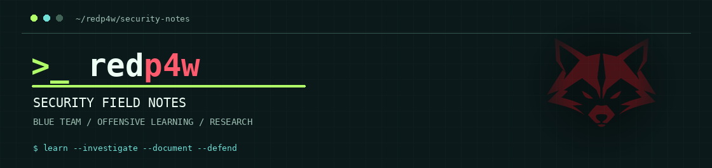
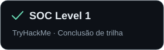
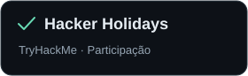
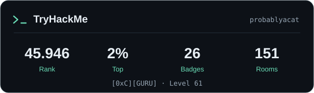

  
    
  <a href="https://redp4w.github.io/">Portfólio</a> &nbsp;·&nbsp;
  <a href="https://tryhackme.com/p/probablyacat">TryHackMe</a> &nbsp;·&nbsp;
  <a href="https://www.credly.com/users/jeh-ferreira">Certificações</a>

## Quem sou

Tecnólogo em Segurança da Informação, entusiasta de tecnologia. Compartilho aqui meus estudos, writeups e walkthroughs sobre segurança ofensiva, SOC, redes e sistemas.

## Últimas publicações

<!-- LATEST:START -->
<table>
<tr><td><code>21.10.2026</code></td><td><a href="https://redp4w.github.io/notes/windows-credential-stores/"><strong>Windows Credential Stores - Do Administrador Local ao Domain Admin</strong></a> walkthrough · publicação no portfólio</td></tr>
<tr><td><code>21.10.2026</code></td><td><a href="https://redp4w.github.io/notes/ad-lateral-movement/"><strong>AD Lateral Movement - PsExec, WinRM, Pass-the-Hash e Pivoting</strong></a> walkthrough · publicação no portfólio</td></tr>
<tr><td><code>19.10.2026</code></td><td><a href="https://redp4w.github.io/notes/ad-authenticated-enumeration/"><strong>Active Directory (AD DS) - Guia prático de enumeração e autenticação</strong></a> guia · publicação no portfólio</td></tr>
</table>
<!-- LATEST:END -->

[Ver todas as publicações ↗](https://redp4w.github.io/arquivo/)

## Skills

**Sistemas e automação**

  &nbsp;
  &nbsp;
  &nbsp;
  &nbsp;
  &nbsp;
  &nbsp;
  

**SOC, SIEM e análise de logs**

  &nbsp;
  &nbsp;
  

**Pentest e segurança web**

  &nbsp;
  &nbsp;
  

**Conhecimentos e ferramentas**

SOC · SIEM · Incident Response · Elastic · Splunk · Sysmon · Volatility 3 · Active Directory · Linux · Kali Linux · Nmap · Wireshark · Metasploit · Burp Suite · ffuf · Hydra · Hashcat · John the Ripper · OWASP · MITRE ATT&CK · GRC · ISO 27001/27002 · LGPD

## Certificados

<!-- CERTIFICADOS / Credly: duplique um <a>...</a>, alterando endereço, imagem e descrição. -->

  &nbsp;
  &nbsp;
  

<!-- CERTIFICADOS / TryHackMe: duplique o link, indicando o PDF e o SVG correspondente. -->

  &nbsp;
  

## TryHackMe

[Ver perfil ↗](https://tryhackme.com/p/probablyacat)

<!-- PLATAFORMAS: inclua aqui um link do Hack The Box quando o perfil público estiver disponível. -->
