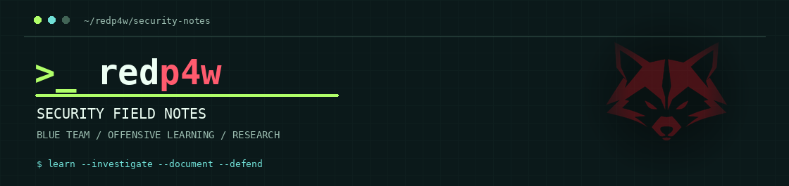
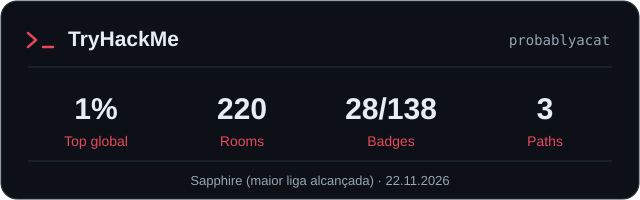

  
    
  <a href="https://redp4w.github.io/">Portfólio</a> &nbsp;·&nbsp;
  <a href="https://tryhackme.com/p/probablyacat">TryHackMe</a> &nbsp;·&nbsp;
  <a href="https://www.credly.com/users/jeh-ferreira">Certificações</a>

## Quem sou

Tecnólogo em Segurança da Informação, entusiasta de tecnologia. Compartilho aqui meus estudos, writeups e walkthroughs sobre segurança ofensiva, SOC, redes e sistemas.

## Últimas publicações

<!-- LATEST:START -->
<table>
<tr><td><code>20.11.2026</code></td><td><a href="https://redp4w.github.io/notes/seguranca-em-ia-llms-supply-chain-prompt-injection/"><strong>Guia: Segurança em LLMs</strong></a> guia · publicação no portfólio</td></tr>
<tr><td><code>14.11.2026</code></td><td><a href="https://redp4w.github.io/notes/operation-promotion-sqli-idor-rce-bcrypt-sudo-find/"><strong>Operation Promotion — SQLi, IDOR, Command Injection e sudo find até root</strong></a> walkthrough · publicação no portfólio</td></tr>
<tr><td><code>14.11.2026</code></td><td><a href="https://redp4w.github.io/notes/operation-coldstart-ssrf-tar-wildcard-cron-root/"><strong>Operation Coldstart — SSRF, FTP anônimo e Tar Wildcard Injection até root</strong></a> walkthrough · publicação no portfólio</td></tr>
</table>
<!-- LATEST:END -->

[Ver todas as publicações ↗](https://redp4w.github.io/arquivo/)

## Skills

**Sistemas e automação**

  &nbsp;
  &nbsp;
  &nbsp;
  &nbsp;
  &nbsp;
  &nbsp;
  

**SOC, SIEM e análise de logs**

  &nbsp;
  &nbsp;
  

**Pentest e segurança web**

  &nbsp;
  &nbsp;
  

**Conhecimentos e ferramentas**

SOC · SIEM · Incident Response · Elastic · Splunk · Sysmon · Volatility 3 · Active Directory · Linux · Kali Linux · Nmap · Wireshark · Metasploit · Burp Suite · ffuf · Gobuster · Hydra · Hashcat · John the Ripper · OWASP · MITRE ATT&CK · GRC · ISO 27001/27002 · LGPD

**Segurança em IA e LLMs**

Prompt injection · Jailbreaks · Testes de segurança em aplicações com LLMs · Supply chain de IA · Desserialização insegura (Pickle) · Fickling · ModelScan · pip-audit · Syft / SBOM

**Prática em laboratórios**

- **SOC / Blue Team:** triagem de alertas, análise de logs, tráfego de rede, eventos Windows/Linux e investigação inicial de incidentes.
- **Pentest web e infraestrutura:** reconhecimento, enumeração, autenticação, SQL Injection, IDOR, SSRF, Command Injection, análise de sessões e escalonamento de privilégios.
- **Active Directory / identidade:** enumeração autenticada, Kerberos, AS-REP Roasting, RBCD e controles de acesso.
- **Sistemas / automação:** Linux, Windows, Python, Bash, PowerShell e scripts para análise e tarefas repetitivas.
- **Segurança de IA:** avaliação de entradas maliciosas, jailbreaks e riscos em modelos, arquivos, dependências e integrações com LLMs.

## Trilhas concluídas no TryHackMe

| Learning path | Conclusão | Foco prático |
| --- | :---: | --- |
| [SOC Level 1](https://tryhackme.com/path/outline/soclevel1) | 07/09/2026 | Monitoramento, análise de eventos, triagem e resposta inicial |
| [Jr Penetration Tester](https://tryhackme.com/path/outline/jrpenetrationtester) | 16/11/2026 | Reconhecimento, pentest web, redes e exploração em laboratório |
| [AI Security](https://tryhackme.com/path/outline/aisecurity) | 22/11/2026 | Prompt injection, jailbreaks, segurança de LLMs e supply chain de IA |

## Labs e guias selecionados

- **Exploração web / Linux:** [Operation Promotion](https://redp4w.github.io/notes/operation-promotion-sqli-idor-rce-bcrypt-sudo-find/) · [Operation Coldstart](https://redp4w.github.io/notes/operation-coldstart-ssrf-tar-wildcard-cron-root/) · [Silent Monitor](https://redp4w.github.io/notes/silent-monitor-sqli-command-injection-keepass-root/)
- **Reconhecimento / Active Directory:** [NexusCorp](https://redp4w.github.io/notes/nexuscorp-do-recon-ao-root/) · [AD: Authenticated Enumeration](https://redp4w.github.io/notes/ad-authenticated-enumeration/)
- **Segurança de IA:** [Guia: Segurança em LLMs](https://redp4w.github.io/notes/seguranca-em-ia-llms-supply-chain-prompt-injection/)

## Certificados

<!-- CERTIFICADOS / Credly: duplique um <a>...</a>, alterando endereço, imagem e descrição. -->

  &nbsp;
  &nbsp;
  

## TryHackMe

**Top 1% global** · **Sapphire (maior liga alcançada)** · **220 rooms** · **28/138 badges** · **3 learning paths concluídos**

[Ver perfil ↗](https://tryhackme.com/p/probablyacat)

<!-- PLATAFORMAS: inclua aqui um link do Hack The Box quando o perfil público estiver disponível. -->
